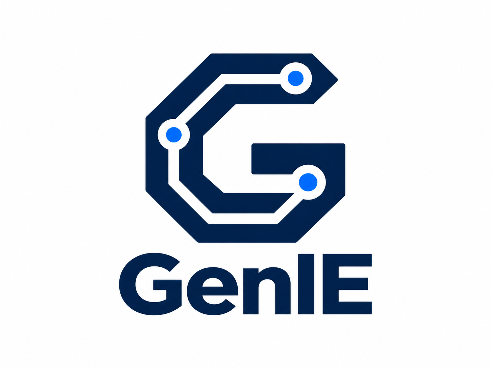

# GenIE

> **Logo attribution:** The GenIE logo was created with the assistance of
> generative AI.

Code for NorCAS Paper: GenIE: Reuse-Oriented Generation of Domain-Specific Instruction Extensions

## Information on open-source release

The full code (including automation and synthesis scripts) will be mage availabel later this year.

Some parts of the implementation are already available via: https://github.com/tum-ei-eda/isaac-toolkit

## Planned features

Support for:
- 64-bit application cores (multi-issue pipelines)
- custom memory & branch instructions
- additional simulators and compilers (e.g. RISCV-GCC)
- alternative retargeting/synthesis tools
- different extension interfaces (i.e. OpenHWGroup CV-X-IF)

## Disclaimer

The HLS tool used in the paper is currently not available at this point in time. We are working on the integration of alternative HLS solutions and extension interfaces.

## Acknowledgment

This research is partially funded by the German Federal Ministry of Education and Research (BMBF) within
the projects [Scale4Edge](https://www.edacentrum.de/scale4edge/) (grant number 16ME0465) and [MANNHEIM-FlexKI](https://www.edacentrum.de/projekte/MANNHEIM-FlexKI) (grant number 01IS22086L).

## Flow web monitor

Launch experiments from a browser form or the CLI, then inspect stages, live
logs, and metrics in the same lightweight web app. See [the monitor guide](docs/monitor.md) for startup and remote access.

### Seal5 source compatibility

Local LLVM retargeting uses the [ISAAC port of current Seal5 main](docs/SEAL5_PORT.md), including the typed CoreDSL parser.

## ISAAC demo alignment

GenIE tracks the audited ISAAC demo sources and supports Spike plugin and CFU
flows with the current retargeting job API. See [the migration guide](docs/MIGRATION.md)
for configuration and validation, and [the Seal5 guide](docs/SEAL5_PORT.md) for
service image rebuilding and repository branches to push.
