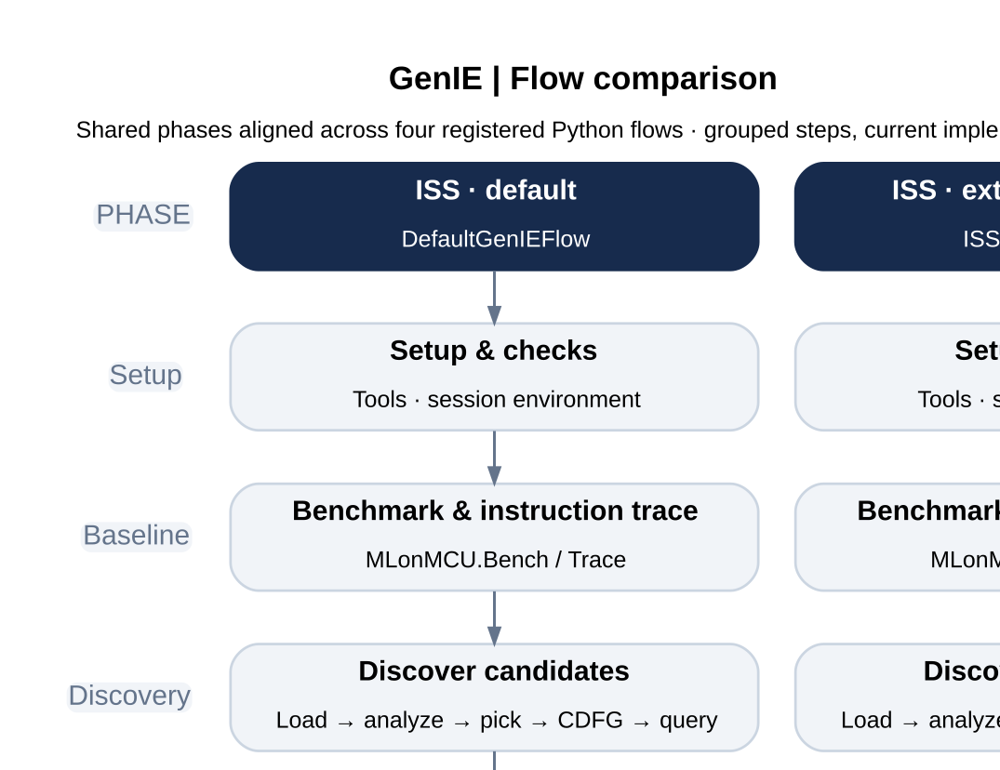
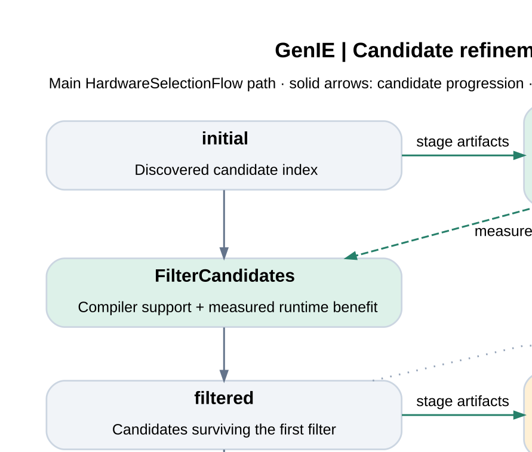

# GenIE flow figures

## Flow comparison



[PDF](flow_comparison.pdf) · [SVG](flow_comparison.svg) · [PNG](flow_comparison.png) · [Graphviz source](flow_comparison.dot)

**Suggested caption:** Comparison of four GenIE flows with common phases aligned
horizontally. Gray blocks identify shared phases, green blocks add evaluation,
blue blocks replace functional simulation with performance simulation, and amber
blocks expand candidate refinement with hardware evaluation. Blocks group multiple
Python steps; they describe the implemented flow structure rather than completed
validation of every external backend.

Included flows: `DefaultGenIEFlow` (default ISS), `ISSEvaluationFlow`,
`PerfSimGenIEFlow`, and `HardwareSelectionFlow`. The RTL placeholder flow is not
included because it does not yet provide a complete RTL execution path.

## Candidate refinement



[PDF](candidate_refinement.pdf) · [SVG](candidate_refinement.svg) · [PNG](candidate_refinement.png) · [Graphviz source](candidate_refinement.dot)

**Suggested caption:** Candidate refinement in `HardwareSelectionFlow`. Solid
arrows show progression from discovered candidates through filtering and selection
to the final instruction set. Evaluation is repeated at explicit stages; dashed
arrows show measurements feeding filtering and selection. These dependencies are
not automatic execution loops. The shorter flows finish after filtered-stage
instruction and core generation. Additional standalone phase routes are omitted
from the main path to retain readability.

`filtered_selected` is produced by iterative specialization-aware selection;
`final` is produced by a separate selection/renaming step. Top-k is optional:
`SELECT_TOPK=0` retains all candidates from the preceding selection. The schematic
shows stages and operations, not proportional candidate counts.

## Editing and regeneration

Use SVG in vector editors and presentation software; use PDF with LaTeX
`\\includegraphics`. PNG exports are provided at 180 dpi for tools that need raster
images. All figures have a white background and use Arial with a sans-serif
fallback from the renderer.

From the repository root, with GenIE installed and Graphviz `dot` available:

```sh
python scripts/generate_flow_diagrams.py
```

`flow_steps.json` is generated directly from each flow's resolved `Steps` list,
including substitutions and stage annotations. The grouped labels/layout in the
Python generator are editorial summaries of those definitions; update them when
changing flow behavior. DOT sources remain independently editable and can be
rendered with `dot -Tpdf input.dot -o output.pdf`.

The implementation sources are `genie/flows/default.py` and
`genie/flows/evaluation.py`; phase-only alternative transitions are in
`genie/prototype.py`. For current execution evidence, see `PROGRESS.md`.
